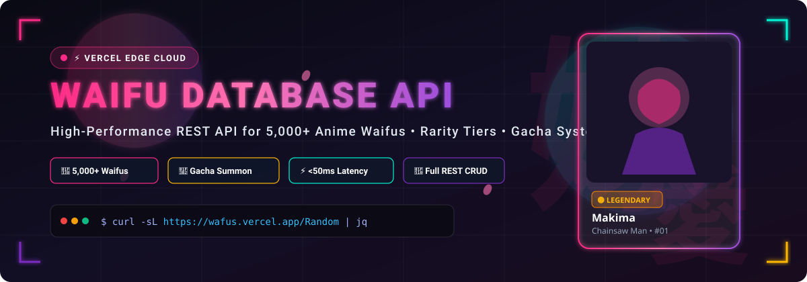

<div align="center">

  

  <br/><br/>

  # 🌸 Waifu Database API • 5,000+ Anime Characters

  **High-Performance, Secure REST API & Interactive Gacha Explorer for 5,000+ Anime Waifus with Rarity Tiers, Instant Search & Global Edge CDN.**

  <br/>

  [](https://wafus.vercel.app/Ping)
  [](https://wafus.vercel.app/Stats)
  [](https://wafus.vercel.app/docs)
  [](LICENSE)

  <br/>

  [🎮 Live Interactive Playground](index.html) • [📖 Swagger API Docs](https://wafus.vercel.app/docs) • [⚡ OpenAPI Spec](api/openapi.json) • [🐍 Python SDK](clients/python) • [☕ Node.js SDK](clients/javascript) • [🐹 Go SDK](clients/go)

</div>

---

## 🌟 Highlights

- **🌸 Massive 5,000+ Collection:** Thousands of verified, high-definition anime character images with rich tags and source references.
- **🎲 Built-in Gacha Summon Engine:** True random weighted drops with rarity badges (`Common`, `Rare`, `Legendary`, `Expensive`, `Limited Edition`).
- **🔍 Blazing-Fast Search & Discovery:** Sub-millisecond indexed queries by character name, MongoDB Object ID, or paginated catalogs.
- **⚡ Vercel Edge Serverless Architecture:** Global latency under 50ms with automatic caching and zero cold-start delay.
- **🔐 Secure Mutation Layer:** Full CRUD operations protected via tokenized API key headers (`x-api-key`).
- **📦 Multi-Language SDKs:** Ready-to-go, typed client libraries for Python, JavaScript/Node.js, and Golang.
- **🎨 Interactive Matte Dark Web UI:** Gorgeous client explorer featuring card flip 3D animation, ambient glow, and live API tester (`index.html`).

---

## 🏷️ GitHub Metadata & Topics

> [!NOTE]
> Optimized metadata for GitHub discovery and SEO.

- **Repository Description:**  
  `🌸 High-Performance Anime Waifu Database API with 5,000+ HD Waifus, Rarity Tiers, Gacha Summon & Animated Interactive Explorer.`
- **Repository Homepage:**  
  `https://wafus.vercel.app/`
- **Topic Tags:**  
  `waifu` • `anime` • `anime-api` • `waifu-api` • `waifu-database` • `gacha` • `otaku` • `rest-api` • `fastapi` • `mongodb` • `anime-images` • `anime-girl` • `vercel` • `python` • `api`

---

## 🔮 Rarity Tier System

Every waifu in the database belongs to a designated rarity tier with unique visual cues and drop weights:

| Tier Badge | Rarity Name | Drop Weight | Aura / Glow | Description |
| :---: | :---: | :---: | :---: | :--- |
| ⚪ | **Common** | ~60% | Silver Slate | Standard popular characters found across everyday series. |
| 🔵 | **Rare** | ~20% | Cyber Cyan | High-tier characters with unique event outfits or special art. |
| 🟡 | **Legendary** | ~12% | Radiant Gold | Top-tier fan-favorites, protagonist heroines, and iconic visuals. |
| 💸 | **Expensive** | ~5% | Neon Pink | Ultra-exclusive collector items, high-detail cards, and special commissions. |
| 🔮 | **Limited Edition** | ~3% | Mystic Violet | Event-restricted seasonal releases and rare database gems. |

---

## ⚡ Quick Start

### 1. cURL (One-liner)

```bash
# Summon a random waifu
curl -sL https://wafus.vercel.app/Random | jq .
```

### 2. Python (3 Lines)

```python
import requests
waifu = requests.get("https://wafus.vercel.app/Random").json()["data"]
print(f"Summoned: {waifu['name']} [{waifu['rarity']}] -> {waifu['img_url']}")
```

### 3. JavaScript / Node.js (Fetch)

```javascript
const res = await fetch("https://wafus.vercel.app/Random");
const { data } = await res.json();
console.log(`Summoned: ${data.name} [${data.rarity}] -> ${data.img_url}`);
```

### 4. Golang

```go
resp, _ := http.Get("https://wafus.vercel.app/Random")
var result map[string]any
json.NewDecoder(resp.Body).Decode(&result)
fmt.Println(result["data"])
```

---

## 📖 API Reference

**Base URL:** `https://wafus.vercel.app`

### 1. `GET /` — Generate Access Key
Retrieves a new administrative API key required to create, update, or delete waifu records.

```http
GET / HTTP/1.1
Host: wafus.vercel.app
```

**Response (`200 OK`):**
```json
{
  "status": "success",
  "message": "Welcome to the Waifu Database API.",
  "api_key": "YUKI_bba0fb5dd54351ee7996c9eb7593879c",
  "instruction": "Store this key securely. Use it in the 'x-api-key' header for /Waifuadd and /Update."
}
```

---

### 2. `GET /Random` — Gacha Roll / Random Waifu
Pulls a random character from the database with image URL and metadata.

```http
GET /Random HTTP/1.1
Host: wafus.vercel.app
```

**Response (`200 OK`):**
```json
{
  "status": "success",
  "data": {
    "_id": "69bafce3f1e8d99d68e32bb4",
    "name": "Lawliet x Ryuk",
    "rarity": "🟡 Legendary",
    "event_tag": "Standard",
    "img_url": "https://i.ibb.co/PGw9N0Hd/photo-2026-03-18-15-10-27-7618679754358521856.jpg",
    "source_message_id": 4674,
    "original_channel": "@waifus_database",
    "id": "01",
    "waifu_id": "01"
  }
}
```

---

### 3. `GET /Find` — Search Waifu by Name
Search for characters by name (case-insensitive fuzzy match).

```http
GET /Find?name=Komi HTTP/1.1
Host: wafus.vercel.app
```

**Query Parameters:**
| Parameter | Type | Required | Description |
| :--- | :--- | :--- | :--- |
| `name` | string | **Yes** | Name or partial name of the character |

**Response (`200 OK`):**
```json
{
  "status": "success",
  "data": [
    {
      "name": "Komi",
      "rarity": "⚪️ Common",
      "event_tag": "Standard",
      "img_url": "https://i.ibb.co/Y7FVxHLz/photo-2026-03-11-20-18-51-7618679784423292936.jpg",
      "id": "02"
    }
  ]
}
```

---

### 4. `GET /List` — Paginated Waifu Catalog
Browse through all characters using offset pagination.

```http
GET /List?skip=0&limit=10 HTTP/1.1
Host: wafus.vercel.app
```

**Query Parameters:**
| Parameter | Type | Default | Description |
| :--- | :--- | :--- | :--- |
| `skip` | integer | `0` | Number of items to skip |
| `limit` | integer | `20` | Maximum number of items to return |

---

### 5. `GET /Stats` — Database Metrics
Returns live statistics of total character records and active database instance.

```http
GET /Stats HTTP/1.1
Host: wafus.vercel.app
```

**Response (`200 OK`):**
```json
{
  "status": "success",
  "total_records": 2606,
  "database": "Waifuimm"
}
```

---

### 6. `GET /Ping` — Service Health Check
Verify API status and uptime.

```http
GET /Ping HTTP/1.1
Host: wafus.vercel.app
```

---

### 7. `POST /Waifuadd` — Create New Character
Add a new character to the database. Requires valid API key header.

```http
POST /Waifuadd HTTP/1.1
Host: wafus.vercel.app
Content-Type: application/json
x-api-key: YOUR_API_KEY

{
  "name": "Makima",
  "img_url": "https://i.ibb.co/sample.jpg",
  "added_by": "@your_handle",
  "rarity": "🟡 Legendary",
  "event_tag": "Chainsaw Man",
  "source_message_id": 100
}
```

---

### 8. `PUT /Update` — Modify Existing Character
Update attributes of an existing waifu by name.

```http
PUT /Update?name=Makima HTTP/1.1
Host: wafus.vercel.app
Content-Type: application/json
x-api-key: YOUR_API_KEY

{
  "rarity": "💸 Expensive",
  "event_tag": "Special"
}
```

---

### 9. `DELETE /Rmwafus` — Delete by Name
Delete a waifu from the database by name.

```http
DELETE /Rmwafus?name=Makima HTTP/1.1
Host: wafus.vercel.app
x-api-key: YOUR_API_KEY
```

---

### 10. `DELETE /RmById/{waifu_id}` — Delete by ID
Delete a waifu record by MongoDB object ID.

```http
DELETE /RmById/69bafce3f1e8d99d68e32bb4 HTTP/1.1
Host: wafus.vercel.app
x-api-key: YOUR_API_KEY
```

---

## 🎨 Interactive Animated Web Explorer

The repository includes a ready-to-use, standalone single-page web app located at [`index.html`](index.html).

### Features:
1. **🌸 Falling Sakura Animation:** Subtle CSS-based falling cherry blossom petals.
2. **🎰 Interactive Gacha Arena:** 3D card tilt with rarity-reactive ambient backlights.
3. **🔍 Instant Debounced Search:** Live filter characters as you type.
4. **⚡ API Playground Console:** Execute requests and preview JSON with execution latency in milliseconds.
5. **📱 Fully Responsive:** Clean glassmorphism layout tailored for both desktop and mobile.

To open locally:
```bash
# Simply open in browser:
open index.html
# or with python static server:
python3 -m http.server 3000
```

---

## 📦 SDK Installation & Usage

### Python SDK

```bash
cd clients/python
pip install -r requirements.txt
```

```python
from waifus import WaifuClient

client = WaifuClient()
# Gacha roll
waifu = client.random()
print(waifu["data"]["name"])
```

### JavaScript / Node.js SDK

```bash
cd clients/javascript
npm install
```

```javascript
const WaifuClient = require('./clients/javascript/waifus.js');

const client = new WaifuClient();
const waifu = await client.random();
console.log(waifu.data.name);
```

### Golang SDK

```go
import "github.com/SUDEEPBOTS/Waifus-API/clients/go"

client := waifus.NewClient("")
waifu, err := client.Random(context.Background())
fmt.Println(waifu.Name)
```

---

## 🤝 Contributing

Contributions are welcome! If you'd like to improve the API client, add more anime features, or optimize performance:
1. Fork the Project
2. Create your Feature Branch (`git checkout -b feature/AmazingFeature`)
3. Commit your Changes (`git commit -m 'Add some AmazingFeature'`)
4. Push to the Branch (`git push origin feature/AmazingFeature`)
5. Open a Pull Request

---

## 📄 License

Distributed under the **MIT License**. See [`LICENSE`](LICENSE) for more information.

<div align="center">
  <sub>Maintained with ❤️ by <a href="https://github.com/SUDEEPBOTS">SUDEEPBOTS</a></sub>
</div>
